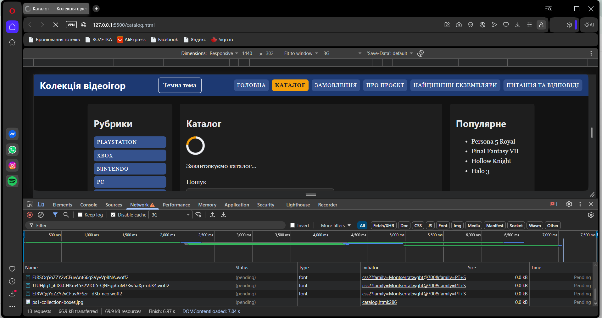
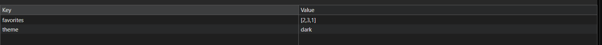
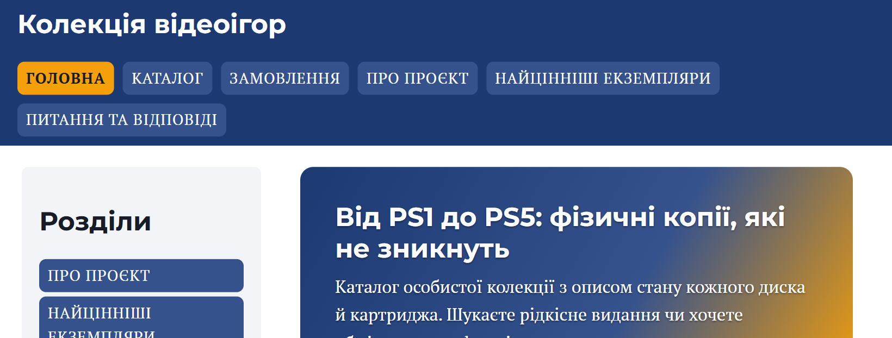
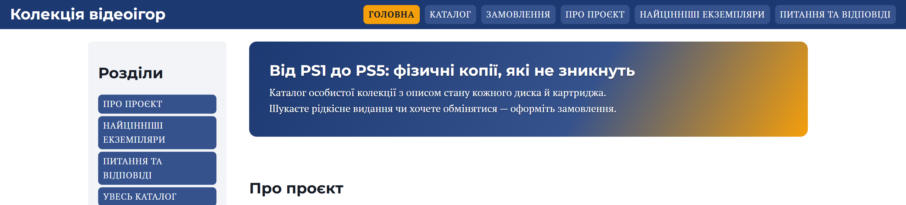

# web-course-2

Сайт «Колекція відеоігор» (університетські лабораторні роботи з веб-розробки). Фінальний проєкт LR10: каталог бере дані з файлу `data.json` через `fetch`.

## Проєкт

- `index.html` — головна, `catalog.html` — каталог, `form.html` — форма замовлення.
- Каталог: картки, пошук за назвою або розробником, фільтр за платформою, сортування, перемикач «Тільки обране», лічильник «Показано N із 10», вікно `<dialog>` з повною інформацією про гру.
- Усі сторінки мають меню, кнопку теми та спільний скрипт `js/app.js`.

## Дані

Дані лежать у `data.json` (варіант 08): 10 записів. Поля: `title`, `developer`, `publisher`, `year`, `platforms` (масив), `genres` (масив), `requirements` (об'єкт: `ram`, `gpu`, `cpu`, `storage_gb`), `modes` (масив), `critics` (масив оцінок).

У файлі немає `id`, тому під час завантаження кожному запису додається `id: index + 1` через `map`. Блок `#demo` з масивом у `catalog.html` видалено, бо дані тепер приходять з `data.json` і демо-блок лише дублював би їх.

Список платформ у фільтрі не прописаний у HTML: він створюється з даних (через `Set`), тому нова платформа в JSON з'явиться у фільтрі сама.

## Завантаження

Функція `loadData()` робить `fetch("data.json")`, перевіряє `response.ok` (бо `fetch` не кидає помилку на 404), читає `response.json()` і перевіряє, що результат — непорожній масив. Запуск у `init()` з `try/catch/finally`.

Індикатор `.loader` показується до запиту й ховається лише у `finally`, тому зникає і після успіху, і після помилки. Скрін спінера: `images/screens/loader.png` (мережа 3G).

## Що бачить користувач, коли сталася помилка

У всіх випадках спінер зникає, а замість карток з'являється червоний блок `#load-error` (`role="alert"`) з повідомленням «Не вдалося завантажити каталог. Перевірте з'єднання і оновіть сторінку» та короткою технічною причиною.

- **404** (файл не знайдено): `fetch` не падає, але `response.ok === false`, код кидає помилку «HTTP 404», `catch` показує повідомлення.
- **Офлайн**: `fetch` відхиляється з `TypeError: Failed to fetch`, `catch` показує повідомлення, `finally` ховає спінер.
- **Зламаний JSON** (зайва кома в `data.json`): `response.json()` кидає `SyntaxError`, `catch` показує повідомлення з причиною.

## Пам'ять

У `localStorage` зберігаються два ключі:

- `favorites` — JSON-масив `id` обраних ігор. Читання й запис обгорнуті в `try/catch`, а `JSON.parse` перевіряє, що результат — масив; пошкоджені дані не ламають сторінку.
- `theme` — `"dark"` або `"light"`.

Кнопка теми перемикає класи `dark-theme` / `light-theme` на `<html>`. Збережений вибір перевіряється раніше за системну схему (`prefers-color-scheme`), бо це свідомий вибір користувача, а системна схема лише значення за замовчуванням: якби першою перевірялась система, кнопка не мала б жодного ефекту після перезавантаження. Якщо вибору немає, діє `@media (prefers-color-scheme: dark)`.

Улюблені можна фільтрувати перемикачем «Тільки обране»; він працює разом із пошуком і платформою.

## Безпека

- У `app.js` немає `innerHTML`: усі дані з файлу й від користувача виводяться через `createElement` і `textContent`, тому вставлений HTML показується як текст.
- Self-XSS тест: у `data.json` (поле `developer` гри Zelda) тимчасово вставлено ``. У картці, у вікні «Детальніше» та в пошуку рядок показується як звичайний текст, `alert` не виконується. Після перевірки дані повернуто (`git restore`).
- Перевірка форми в браузері не є захистом даних: її можна обійти, тому справжню перевірку має робити сервер.

## Перевірка валідатором W3C

| Сторінка | Помилок до | Помилок після |
|---|---|---|
| index.html | 0 | 0 |
| catalog.html | 0 | 0 (1 попередження: порожній `<h3>` у `<dialog>`, його заповнює JS) |
| form.html | 0 | 0 |

## Скріншоти

