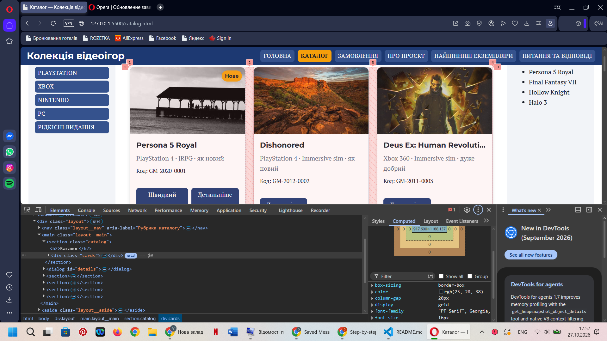

# web-course-2

## Перевірка валідатором W3C
| Сторінка | Errors до | Errors після | Що виправлено |
|---|---|---|---|
| index.html | 0 | 0 | — |
| catalog.html | 0 | 0 | — |
| form.html | 0 | 0 | — |

## Чому клієнтської валідації недостатньо

Під час перевірки в DevTools я видалив атрибут `required` з поля прямо в браузері через панель Elements/Console — і форма одразу почала пропускати це поле, дозволяючи відправити дані без нього. При цьому сам файл `form.html` на диску не змінився: після оновлення сторінки (F5) атрибут `required` повернувся на місце. Це показує, що клієнтська валідація (HTML5-атрибути, JavaScript у браузері) — це лише зручність для користувача, а не захист: будь-хто, хто відкриє інструменти розробника, може обійти будь-які обмеження на сторінці або взагалі надіслати запит напряму, минаючи форму. Тому остаточну перевірку й очищення даних завжди повинен виконувати сервер (backend), якому не можна довіряти нічого, що прийшло від клієнта.

## Оформлення (LR4)

### Шрифти

Підключено через `@import` першим рядком `css/styles.css` із набором символів `cyrillic`.

- **Montserrat** 700 — заголовки, легенди форми: https://fonts.google.com/specimen/Montserrat
- **PT Serif** 400 і 700 — основний текст: https://fonts.google.com/specimen/PT+Serif

Разом 2 гарнітури і 3 накреслення. Запасні стеки: `"Segoe UI", sans-serif` для заголовків і `Georgia, "Times New Roman", serif` для тексту.

### Змінні палітри

| Змінна | Призначення |
|---|---|
| `--color-brand` | шапка, шапка таблиці, заголовок картки Persona |
| `--color-accent` | активний пункт меню, кнопка «Забронювати», зірочка обов'язкового поля |
| `--color-bg` | фон сторінки |
| `--color-surface` | картки, парні рядки таблиці, підвал |
| `--color-text` | основний текст |
| `--color-muted` | другорядний текст, відвідані посилання, цитата |
| `--color-border` | рамки таблиці, полів і fieldset |
| `--color-invalid`, `--color-invalid-bg` | невалідне поле у фокусі |
| `--color-valid`, `--color-valid-bg` | валідне поле у фокусі |
| `--color-on-brand` | білий текст на синьому фоні |
| `--color-brand-light` | плитки пунктів меню |

Некольорові змінні: `--radius`, `--space`, `--shadow`, `--font-heading`, `--font-body`.

### Найскладніший селектор

Найскладнішим виявився `label:has(+ input:required)::after` для позначення обов'язкових полів зірочкою. У розмітці `<label>` стоїть перед `<input>`, а звичайні комбінатори `+` і `~` вміють обирати лише елементи, що йдуть *після*. Тому знадобився `:has()`, який дозволяє стилізувати підпис залежно від того, яке поле стоїть за ним.
## LR5. Блокова модель і позиціонування

### object-fit

- **fill** — зображення розтягується рівно під рамку 100% × 170px, пропорції ламаються: вертикальна обкладинка сплющується по висоті й виглядає «товстою».
- **contain** — зображення вписується повністю зі збереженням пропорцій, тому по боках (у вертикального) або зверху й знизу (у горизонтального) лишаються порожні поля — це вільне місце рамки, яке фото не заповнило.
- **cover** — зображення заповнює всю рамку без спотворень, але те, що не влазить, обрізається по краях: у вертикальної обкладинки втрачається верх і низ.

### Три крапки

- Без `white-space: nowrap` довга назва просто переноситься на кілька рядків, і крапки не з'являються — обрізати нічого.
- Без `overflow: hidden` текст в один рядок вилазить за праву межу картки, крапки теж не малюються.
- Без `text-overflow: ellipsis` текст обрізається, але різко, посеред літери, без «…».

### Схлопування відступів

Схлопування відбувається, коли вертикальні `margin` двох блокових елементів стикаються: між сусідами, між батьком і першою/останньою дитиною без `padding` чи `border` між ними, у порожнього блока. Замість суми браузер бере більший із двох відступів. Практичне правило — задавати вертикальні відступи тільки в один бік (у цій роботі — тільки `margin-bottom`), тоді двом відступам просто нема де зустрітися.

### Перевірка валідатором W3C

| Сторінка | Errors до | Errors після |
|---|---|---|
| index.html | 0 | 0 |
| catalog.html | 0 | 0 |
| form.html | 0 | 0 |

## LR6. Макет сторінки: Grid і Flexbox

### Адаптивна сітка

Під час звуження вікна сітка каталогу перебудовується приблизно так:
- 4 → 3 колонки: ~1540 px
- 3 → 2 колонки: ~1280 px
- 2 → 1 колонка: ~1020 px

Медіазапитів немає: `minmax(var(--min-col), 1fr)` не дає колонці стати вужчою за 240 px, а `auto-fit` ставить стільки колонок, скільки вміщається з урахуванням `gap`. Коли ширини стає менше, ніж n × 240 px + проміжки, одна колонка переходить у новий ряд.

`auto-fill` з двома картками залишає порожні колонки, і картки лишаються вузькими, а `auto-fit` згортає порожні колонки, і дві картки розтягуються на всю ширину.

### Areas

Коли в `grid-template-areas` поміняти місцями `nav` і `side`, бічні колонки міняються місцями без жодної правки HTML. Це доводить, що розташування блоків на екрані задає CSS, а порядок у розмітці лишається логічним (і саме його читає екранна читалка).

### Sticky і Grid

Липкий елемент «їздить» лише в межах свого батьківського контейнера. Якщо покласти `<header>` у `.layout`, його областю стає один низький рядок сітки, тож рухатися йому нікуди, і липкість зникає. Тому `<header>` лишається поза `.layout`, а сітка описує тільки nav / main / side / foot.

### dialog

- Вікно закривається клавішею Esc.
- Поки вікно відкрите, сторінка позаду не прокручується. Сам `<dialog>` у браузері Opera прокрутку не блокував, тому я додав правило `body:has(dialog[open]) { overflow: hidden; }`.
- Затемнення тла не є окремим елементом: його малює псевдоелемент `::backdrop`.

### Скріншот сітки

### Перевірка валідатором W3C (LR6)

| Сторінка | Errors до | Errors після |
|---|---|---|
| index.html | 0 | 0 |
| catalog.html | 0 | 0 |
| form.html | 0 | 0 |